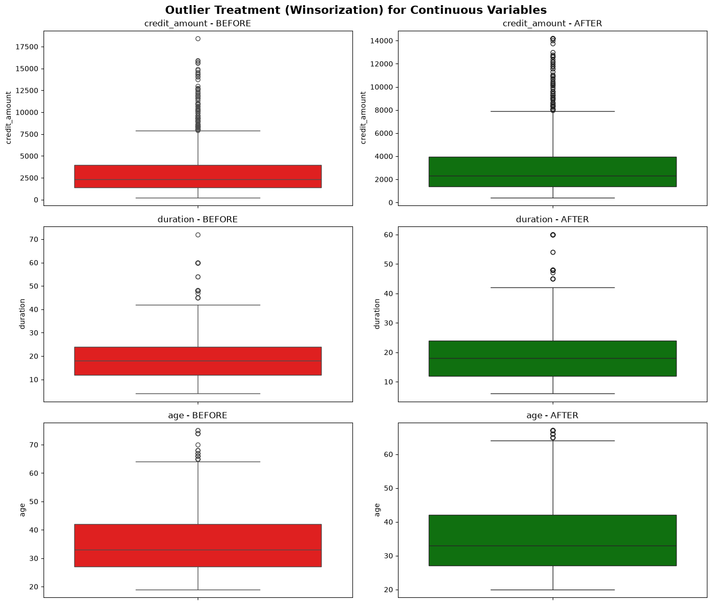
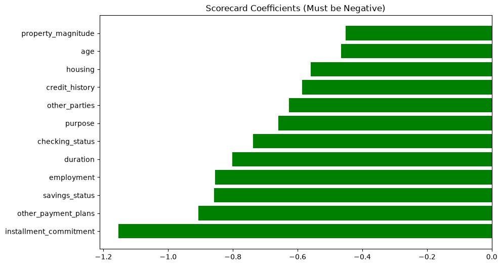
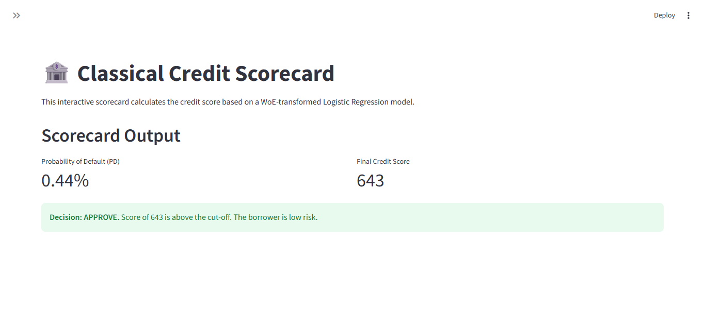
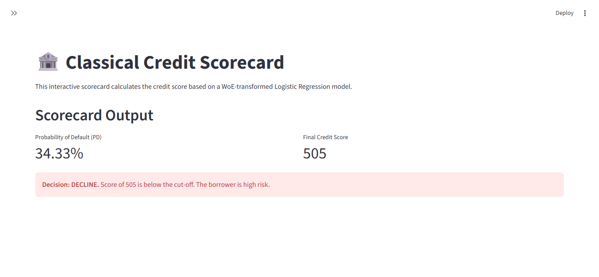

# German_Credit_Scorecard
Traditional retail credit scorecard using WoE/IV variable selection, Logistic Regression, and PDO scaling (300-850).

# Classical Retail Credit Scorecard (German Credit Data)

## Overview
This repository contains a traditional, regulatory-grade retail credit scorecard built on the 1,000-loan German Credit dataset. It strictly follows the Model Risk Management (MRM) lifecycle, from Data Audit to Scorecard Scaling (300-850 PDO methodology).

## Model Development Lifecycle

### 1. Data Audit & Cleaning
We profiled missingness and excluded protected classes (`personal_status`, `foreign_worker`) to comply with regulatory red flags. We applied 1% and 99% Winsorization to continuous variables (`credit_amount`, `duration`, `age`) to handle extreme outliers without losing portfolio volume.

*Figure 1: Winsorization of continuous variables. The extreme right-tail outliers are capped to stabilize the regression coefficients.*

### 2. Variable Selection (WoE & IV)
We binned all continuous variables and calculated Weight of Evidence (WoE) and Information Value (IV). Features with IV < 0.02 (e.g., `job`, `own_telephone`) were dropped. We also identified a 0.63 correlation between `credit_amount` and `duration`, and resolved it by dropping `credit_amount` (lower IV).

👉 **[Click here to view the full Information Value (IV) Table](./german_iv_table.csv)**

### 3. Model Development
We trained a Logistic Regression on the WoE-transformed features. By using WoE, we ensured the model is strictly monotonic. We achieved a **Gini of 0.6412** (AUC 0.8206).

*Figure 2: Logistic Regression Coefficients. The fact that every single bar is negative proves there is zero multicollinearity and the WoE transformation was successful.*

### 4. Scorecard Scaling (PDO)
We converted the logistic regression log-odds into a 300-850 point scale using the PDO (Points to Double the Odds) methodology. 

## Interactive Dashboard
The Streamlit app (`german_app.py`) allows a user to simulate a new applicant by adjusting the WoE values of the most important features. It outputs the Probability of Default and the Final Credit Score.

**Approve Scenario (Score > 650)**

**Decline Scenario (Score < 550)**

---
**Author:** Raymond Sibanda | [LinkedIn](https://www.linkedin.com/in/raymond-sibanda)
FRM | BSc Mathematics | BCom Honors Accounting
